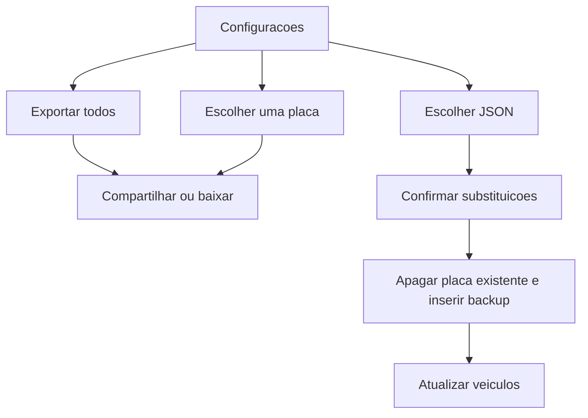

# Tela de configurações: exportar e importar

## Acesso

A tela fica em [`app/configuracoes.tsx`](app/configuracoes.tsx), fora do grupo `(app)`, no mesmo padrão de [`app/vehicles.tsx`](app/vehicles.tsx). Assim ela abre mesmo quando não há veículo cadastrado — hoje [`app/index.tsx`](app/index.tsx) só mostra o cadastro e impede chegar a qualquer tela interna.

- No [`src/components/PlateHeader.tsx`](src/components/PlateHeader.tsx), um botão de engrenagem à direita da placa abre `/configuracoes`.
- Na tela inicial vazia, um botão **Importar backup** abaixo do formulário abre a mesma tela.

## Formato do arquivo

Um único JSON (`application/json`), para compartilhar por WhatsApp, Arquivos, e-mail etc.

```json
{
  "format": "car-services",
  "version": 1,
  "exportedAt": "2026-10-08T12:00:00.000Z",
  "vehicles": []
}
```

Cada veículo leva marca, modelo, placa e `createdAt`, mais os registros das 11 tabelas de manutenção (óleo do motor, câmbio, arrefecimento, velas, bobinas, correias, filtros, suspensões e freios). IDs locais e `is_active` não entram no arquivo. Cada foto (`photo_uri_1` / `photo_uri_2`) vai embutida em base64; se o arquivo local não existir mais, a foto sai como `null` e o registro continua.

Nome do arquivo: `car-services-todos-YYYYMMDD.json` ou `car-services-PLACA-YYYYMMDD.json`.

## Exportar

Módulo [`src/backup/exportBackup.ts`](src/backup/exportBackup.ts) lê o SQLite, monta o JSON e grava em cache com a API `File` do `expo-file-system` já usada no projeto.

- **Exportar todos** usa `listVehicles()`.
- **Exportar um veículo** mostra a lista de placas na própria tela; ao tocar, gera o arquivo só daquele veículo.
- No celular, `expo-sharing` `shareAsync` abre a folha de compartilhamento (`mimeType: application/json`).
- Na web, o compartilhamento de arquivo local não funciona; o fallback é o download do JSON pelo navegador.

## Importar

`expo-document-picker` com `copyToCacheDirectory: true` e tipo JSON. [`src/backup/importBackup.ts`](src/backup/importBackup.ts) valida `format` e `version`. Arquivo inválido ou versão desconhecida mostra alerta em português e não grava nada.

Antes de gravar, um `Alert` lista as placas que **já existem** e serão substituídas, e as placas novas. Só continua se o usuário confirmar.

Para cada veículo do arquivo, dentro de transação:

- Se a placa (normalizada) já existe, apaga os registros das 11 tabelas, os arquivos de foto e a linha do veículo.
- Insere o veículo e os registros de novo. Fotos são gravadas nas pastas que o app já usa (`oil-photos`, `coolant-photos`, etc.), reutilizando as funções `persist*Photo`.
- Veículo substituído que era o ativo continua ativo. Placa nova não toma o lugar do ativo. Se depois da importação não houver nenhum ativo (banco vazio), o primeiro veículo importado fica ativo.

Ao terminar, `refresh()` do [`src/vehicles/VehicleContext.tsx`](src/vehicles/VehicleContext.tsx). Se a importação criou o primeiro veículo a partir da tela vazia, navega para `/home`.



## Dependências

Instalar com `npx expo install expo-sharing expo-document-picker` (SDK 57). Sem plugin de share extension: o app só envia o arquivo, não recebe compartilhamento de outros apps.

## Verificação

`npx tsc --noEmit` e `npx expo lint`. A tela é mobile; o compartilhamento nativo não dá para exercitar no navegador. Na web, conferir se a tela abre, se a lista de veículos aparece e se o download do JSON dispara.