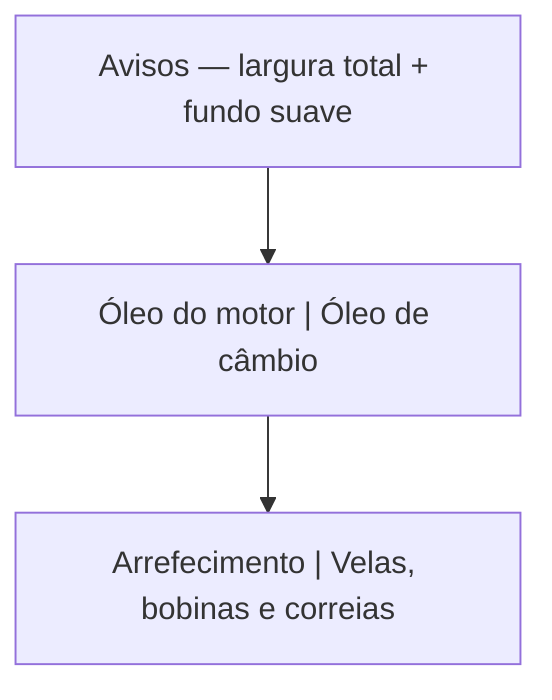

# Avisos em largura total com destaque leve

O grid em [`app/(app)/home.tsx`](app/(app)/home.tsx) agrupa `MODULES` de dois em dois. Avisos fica na célula esquerda da primeira linha, ao lado de “Troca de óleo do motor”.

## Layout

- Separar Avisos dos demais módulos.
- Renderizar Avisos numa linha própria com `width: 100%`, acima do grid.
- Os quatro módulos restantes continuam em duas linhas de duas colunas, como hoje.

## Destaque

- Fundo `rgba(245, 196, 0, 0.12)`, derivado de `theme.colors.primary` (`#F5C400`) em [`src/theme/theme.ts`](src/theme/theme.ts).
- Manter ícone, título, descrição, borda inferior e o `Link` para `/avisos`.
- Sem borda extra nem mudança de tipografia, para o destaque continuar discreto no fundo `#121212`.
