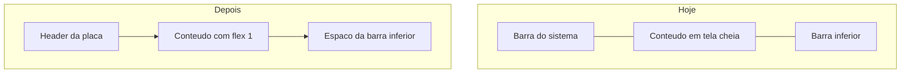

# Espaçamento para o conteúdo não vazar

O app desenha edge-to-edge (Expo SDK 57 no Android). Duas coisas fazem o conteúdo sair da área visível:

- Em [`app/(app)/_layout.tsx`](app/(app)/_layout.tsx), `PlateHeader` e o `Stack` estão soltos num fragmento. O navigator ocupa a tela inteira e o conteúdo da home começa por baixo do header da placa.
- Não há inset inferior. A lista e os botões descem por baixo da barra de navegação do Android (e do indicador do iOS). `SafeAreaView` do React Native, usado em [`app/vehicles.tsx`](app/vehicles.tsx) e [`src/components/VehicleForm.tsx`](src/components/VehicleForm.tsx), não aplica esse inset no Android — o log do Metro já avisa que esse componente está deprecado.

## Mudanças

- Em [`app/(app)/_layout.tsx`](app/(app)/_layout.tsx), envolver header e stack num `View` com `flex: 1`. O `Stack` fica com `flex: 1` abaixo do [`PlateHeader`](src/components/PlateHeader.tsx), e o container ganha `paddingBottom` com `useSafeAreaInsets()`. O fundo continua `theme.colors.background`.
- Em [`app/(app)/home.tsx`](app/(app)/home.tsx), somar o inset inferior ao `padding` do `contentContainerStyle` do scroll, para o último card não encostar na barra.
- Em [`src/components/ModuleScreen.tsx`](src/components/ModuleScreen.tsx), o mesmo inset no padding inferior do container.
- Trocar `styled.SafeAreaView` por `SafeAreaView` de `react-native-safe-area-context` em [`app/vehicles.tsx`](app/vehicles.tsx) e [`src/components/VehicleForm.tsx`](src/components/VehicleForm.tsx). Na lista de veículos, o `FlatList` ganha `flex: 1` para rolar entre o título e os botões, sem empurrar o rodapé para fora da tela.

O header da placa já usa `insets.top`; isso permanece.
