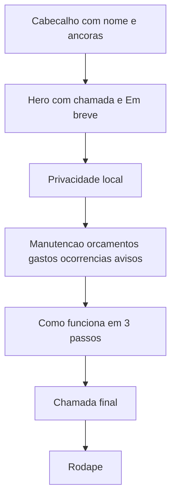

# Landing page estática do Car Services

Site independente do app Expo, em [`site/`](site/), sem build, sem framework e sem alterar as telas do mobile. A pasta abre direto no navegador e pode ser publicada sozinha.

## Visual e tom

Seguir o tema do app em [`src/theme/theme.ts`](src/theme/theme.ts): fundo `#121212`, superfície `#1E1E1E`, texto branco, texto secundário `#B3B3B3`, destaque `#F5C400`. Mobile primeiro, depois desktop. Texto em português, direto, no mesmo espírito do [README](README.md): histórico de manutenção no próprio aparelho, sem conta e sem nuvem.

## Arquivos

- [`site/index.html`](site/index.html) — página única, semântica, `lang="pt-BR"`
- [`site/styles.css`](site/styles.css) — layout, tipografia do sistema e estados de foco
- [`site/assets/icon.png`](site/assets/icon.png) e [`site/assets/capa.png`](site/assets/capa.png) — cópias de [`assets/icon.png`](assets/icon.png) e [`docs/images/capa.png`](docs/images/capa.png), para a pasta funcionar sozinha

Sem JavaScript. O menu usa âncoras. O botão principal é um `button` desabilitado com o texto **Em breve**, e uma linha curta: “Disponível em breve para Android.”

## Seções

- **Cabeçalho:** ícone, nome Car Services e links para as seções.
- **Hero:** título sobre guardar a manutenção do carro no celular; subtítulo sem conta e sem nuvem; botão “Em breve”; ilustração da capa.
- **No seu aparelho:** dados no SQLite local, fotos no armazenamento do app, um veículo ativo por vez.
- **O que o app faz:** manutenção (óleo, filtros, freios, suspensão e os demais módulos), orçamentos com aprovação, gastos dos orçamentos aprovados, ocorrências com mídia e avisos por data e quilometragem.
- **Como funciona:** cadastrar o veículo, registrar a troca, acompanhar o próximo prazo.
- **Fecho:** repetir o botão “Em breve”.
- **Rodapé:** nome do app e a frase de que os dados ficam no aparelho.

## Fora de escopo

Lojas, APK, formulário, analytics, blog e qualquer mudança no app Expo ou no `.gitignore`.
