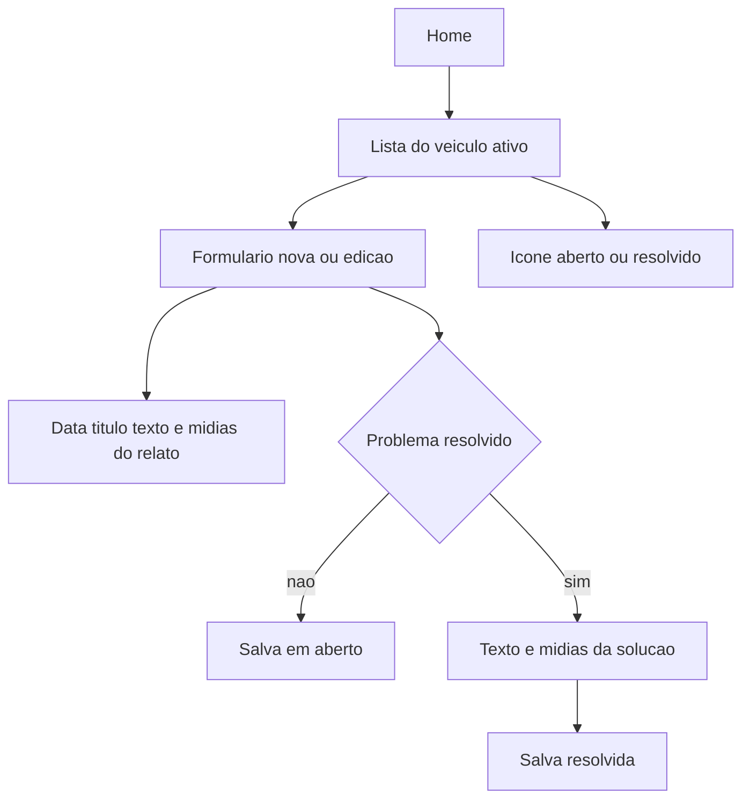

# Módulo Ocorrências

Nome escolhido: **Ocorrências**. Cobre o relato do problema e o registro da solução, e entra na grade da home como os demais módulos.

Cada ocorrência pertence ao veículo ativo. "Mandar" significa anexar um arquivo já existente (galeria ou arquivos); "gravar" significa capturar na hora. Não há envio para outra pessoa nem servidor.

## Fluxo

- Lista em [`app/(app)/ocorrencias.tsx`](app/(app)/ocorrencias.tsx): data, título e ícone. Aberto usa triângulo de alerta na cor primária; resolvido usa check preenchido em verde. Toque abre a edição. Botão para nova ocorrência. Estado vazio quando não houver registros.
- Formulário em [`app/(app)/ocorrencia.tsx`](app/(app)/ocorrencia.tsx), com `id` opcional na rota:
  - Data (padrão: hoje), título obrigatório, texto opcional.
  - Mídias do relato, sem limite de quantidade: foto (câmera ou galeria), vídeo (câmera ou galeria), áudio (gravar ou escolher arquivo).
  - Interruptor **Problema resolvido**. Ligado, abre texto da solução e os mesmos tipos de mídia da solução (foto incluída, para o conserto poder ser mostrado).
  - Salvar como não resolvido descarta texto e arquivos da solução, com confirmação se já houver conteúdo.
  - Excluir a ocorrência remove o registro e os arquivos.

Card na home em [`app/(app)/home.tsx`](app/(app)/home.tsx) e rota registrada em [`app/(app)/_layout.tsx`](app/(app)/_layout.tsx).

## Dados

Duas tabelas em [`src/db/index.ts`](src/db/index.ts), criadas na migração existente:

- `occurrences`: `vehicle_id`, `occurred_on`, `title`, `notes`, `resolved`, `resolution_notes`, `created_at`.
- `occurrence_media`: `occurrence_id`, `purpose` (`report` ou `resolution`), `kind` (`photo`, `audio` ou `video`), `uri`, `created_at`.

Arquivos copiados para `occurrence-media/` no diretório de documentos, no mesmo estilo de [`src/db/oilPhotos.ts`](src/db/oilPhotos.ts). Acesso em [`src/db/occurrences.ts`](src/db/occurrences.ts).

Backup em [`src/backup/schema.ts`](src/backup/schema.ts), [`src/backup/exportBackup.ts`](src/backup/exportBackup.ts) e [`src/backup/importBackup.ts`](src/backup/importBackup.ts): versão 2 inclui as ocorrências e as mídias. Importação da versão 1 continua válida e entra sem ocorrências. Vídeos aumentam o tamanho do arquivo exportado.

## Mídia

Pacotes via `npx expo install`, conferindo a documentação do Expo SDK 57 antes de usar a API:

- `expo-audio` para gravar e reproduzir áudio.
- `expo-video` para reproduzir vídeo.
- `expo-image-picker` (já instalado) para foto e vídeo.
- `expo-document-picker` (já instalado) para escolher áudio.

Em [`app.json`](app.json), liberar microfone no plugin do image picker e textos de permissão de câmera, fotos e microfone. Essas bibliotecas nativas exigem um novo build do app; o Expo Go não basta depois de instalá-las.

Cada item da mídia mostra prévia (imagem, player de áudio ou vídeo) e botão para remover. Alvo principal: Android e iOS. Na web, escolher arquivo continua disponível; gravar pode não existir e a tela avisa isso.

## Fora deste módulo

Quilometragem, notificações e compartilhamento do relato para fora do app.