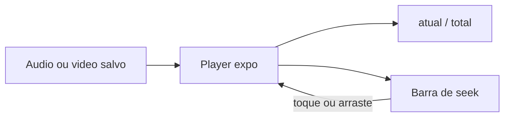

# Linha do tempo de mídia e textos da ocorrência

## Reprodução de áudio e vídeo

Hoje, em [`src/components/OccurrenceMediaSection.tsx`](src/components/OccurrenceMediaSection.tsx), o áudio só tem Ouvir/Pausar e cada play chama `seekTo(0)`. O vídeo usa `nativeControls` num quadro de 180px, sem tempo explícito no mesmo padrão do áudio.

Um controle único, em JavaScript (sem dependência nova), entra nos dois players:

- Tempo no formato `m:ss` / `m:ss` (posição atual e duração total).
- Barra tocável e arrastável. A posição do toque vira segundos: áudio com `player.seekTo`; vídeo com `player.currentTime`.
- Enquanto arrasta, a barra segue o dedo e ignora as atualizações do player até soltar.
- Ouvir/Pausar no áudio passa a continuar de onde parou. Só volta ao início se a faixa já tiver terminado (`didJustFinish` ou posição no fim).
- No vídeo, `nativeControls={false}`, botão Reproduzir/Pausar e a mesma barra. `timeUpdateEventInterval` em cerca de `0.25` e o evento `timeUpdate` do `expo-video` (SDK 57) atualizam a posição. Duração vem de `player.duration`.
- Se a duração ainda for 0, a barra fica desativada e os dois tempos mostram `0:00`.

A gravação em si não ganha essa barra: durante a captura ainda não existe trecho para avançar ou voltar. O cronômetro da câmera continua o do sistema; o áudio continua com o botão Parar.

## Textos que evoluem até a solução

O campo `notes` em [`src/db/occurrences.ts`](src/db/occurrences.ts) é um texto só, editável por cima. O pedido é outro: o que já foi salvo permanece, e dá para acrescentar informação nova enquanto **Problema resolvido** estiver desligado.

Nova tabela `occurrence_notes` (`occurrence_id`, `body`, `created_at`), criada na migração de [`src/db/index.ts`](src/db/index.ts). Cada `occurrences.notes` já existente vira a primeira linha. A coluna antiga deixa de ser lida e gravada.

Em [`app/(app)/ocorrencia.tsx`](app/(app)/ocorrencia.tsx):

- Ocorrência nova, ainda não salva: um campo Texto, como hoje. Ao salvar, ele vira o primeiro registro.
- Ocorrência já salva e não resolvida: os textos anteriores aparecem só para leitura, com data e hora. Embaixo, um campo vazio **Nova informação**. Salvar com esse campo preenchido acrescenta um registro; vazio não cria linha.
- Com **Problema resolvido** ligado: a lista continua visível e o campo de nova informação some. O texto e as mídias da solução seguem como estão hoje.
- Textos já salvos não são editados nem apagados. Título, data e mídias do relato continuam editáveis.

Ao desmarcar resolvido e salvar, a solução atual continua sendo descartada (comportamento já existente). Os textos do relato permanecem e o campo de nova informação volta.

## Backup

[`src/backup/schema.ts`](src/backup/schema.ts) sobe para a versão 3, ainda aceitando importar 1 e 2. Cada ocorrência exporta `updates: { body, createdAt }[]` em [`src/backup/exportBackup.ts`](src/backup/exportBackup.ts). Na importação da versão 2, `notes` vira o primeiro update. A versão 3 grava a lista em `occurrence_notes`.

## Verificação

`npx expo lint` e `npx tsc --noEmit`. A reprodução e o toque na barra dependem de aparelho ou emulador; o typecheck não cobre o gesto.