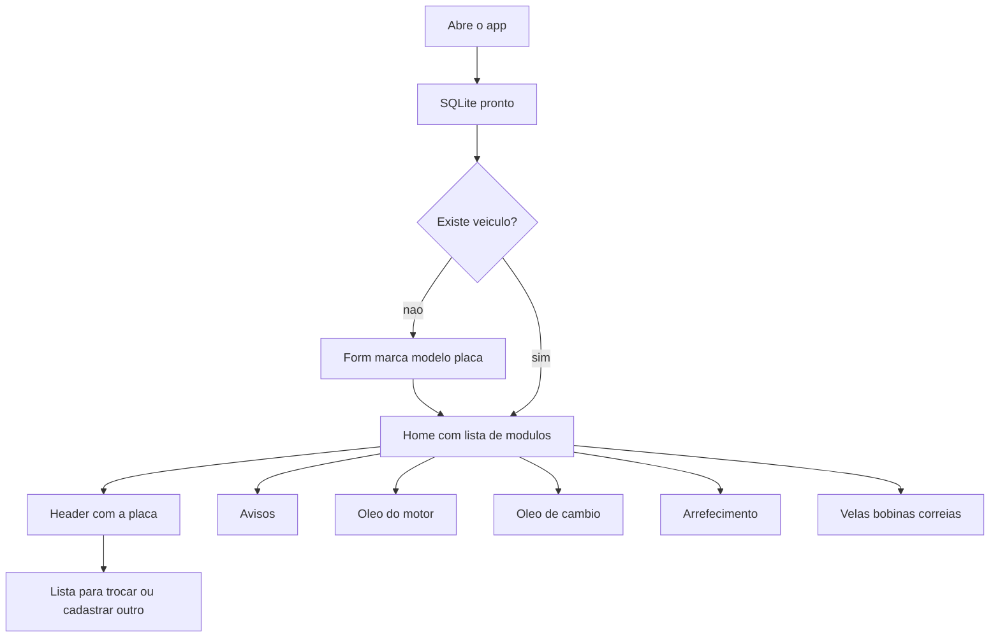

# Cadastro de veículos e módulos

A base já existe: Expo Router em [`app/`](app/_layout.tsx), tema em [`src/theme/theme.ts`](src/theme/theme.ts) e SQLite aberto em [`src/db/index.ts`](src/db/index.ts). A tela de apresentação em [`app/index.tsx`](app/index.tsx) deixa de ser a entrada e vira o portão do fluxo.

## Fluxo

- Sem veículos: formulário em tela cheia, sem header de placa. Campos obrigatórios: **Marca**, **Modelo** e **Placa**. Placa salva em maiúsculas, sem espaços. Placa repetida é recusada.
- Com veículos: home com os cinco módulos. O primeiro cadastro já entra como veículo ativo.
- Header em todas as telas depois do cadastro mostra só a placa. Toque na placa abre a lista de veículos (marca, modelo e placa), com ação para cadastrar outro. Trocar marca o escolhido como ativo e o header atualiza na hora. O novo cadastro também vira o ativo.

## Dados

Tabela `vehicles` criada na abertura do banco, junto de [`openDatabase`](src/db/index.ts):

- `id`, `brand`, `model`, `plate` (única), `is_active`, `created_at`
- Acesso em `src/db/vehicles.ts` (`list`, `getActive`, `create`, `setActive`) com `execAsync`, `runAsync` e `getAllAsync` do `expo-sqlite` já instalado.
- `VehicleProvider` em `src/vehicles/VehicleContext.tsx` carrega a lista depois do banco abrir e é usado pelo header e pelas telas. Envolve o app em [`app/_layout.tsx`](app/_layout.tsx), depois do banco estar pronto.

## Telas

Rotas continuam em `app/` (padrão atual do projeto), com `styled-components` e o tema escuro/amarelo.

- [`app/index.tsx`](app/index.tsx): se não houver veículo, mostra o form; se houver, redireciona para a home.
- `app/register.tsx`: o mesmo form, para o segundo veículo em diante.
- `app/vehicles.tsx`: lista para alternar e botão de cadastrar.
- `app/(app)/_layout.tsx`: stack com header customizado (placa tocável).
- `app/(app)/index.tsx`: lista dos módulos.
- Um arquivo por módulo, com título e um parágrafo curto, via um componente simples `ModuleScreen`:
  - `avisos.tsx` — Avisos
  - `oleo-motor.tsx` — Troca de óleo do motor
  - `oleo-cambio.tsx` — Troca de óleo de câmbio
  - `arrefecimento.tsx` — Troca de arrefecimento
  - `velas-bobinas-correias.tsx` — Troca de velas, bobinas e correias

Nada de formulário de manutenção neste ciclo: só o texto de cada módulo.

## Fora deste ciclo

Histórico, datas, quilometragem e alertas reais. A tela de avisos fica só com texto.
