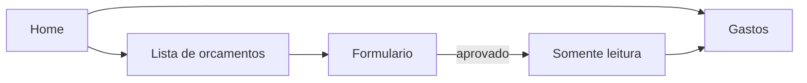

# Orçamentos e gastos

Orçamentos e gastos ficam no veículo ativo, no mesmo padrão de [ocorrências](app/(app)/ocorrencias.tsx): cartão na home, telas no stack e dados no SQLite local.

Gastos não tem cadastro próprio. A lista é a dos orçamentos com `approved = 1`, e o total é a soma desses valores.

## Dados

Duas tabelas em [src/db/index.ts](src/db/index.ts), com acesso em `src/db/quotes.ts`:

- `quotes`: `vehicle_id`, `name`, `store_name`, `quoted_on` (data local de criação, via `todayLocalIso()`), `approved` (0/1)
- `quote_items`: `quote_id`, `name`, `link` (opcional), `price_cents` (inteiro em centavos), `position`

Preço em centavos evita erro de soma com decimal. Na tela, o valor entra e sai em real, formato `pt-BR` (ex.: `1.234,56`).

Regras no banco, não só na tela:

- Nome, loja e pelo menos um item são obrigatórios para salvar. Cada item exige nome e preço maior ou igual a zero. Link vazio vira `null`.
- Enquanto `approved = 0`: criar, editar itens e apagar (com confirmação, como em [ocorrencia.tsx](app/(app)/ocorrencia.tsx)).
- Salvar com o toggle ligado grava `approved = 1`. A partir daí `save` e `delete` recusam a operação. Não dá para desaprovar.

## Telas

Entradas novas em [app/(app)/home.tsx](app/(app)/home.tsx) e [app/(app)/_layout.tsx](app/(app)/_layout.tsx):

- **Orçamentos** (`/orcamentos`): lista com nome, loja, data, total e selo de aprovado. Botão para novo.
- **Orçamento** (`/orcamento`): nome, loja, data só leitura, lista de itens (nome, link, preço, remover), botão de adicionar item, soma no final e toggle Aprovado. Salvar e Apagar só aparecem se ainda não estiver aprovado. Aberto já aprovado, tudo fica somente leitura, inclusive o toggle.
- **Gastos** (`/gastos`): cada orçamento aprovado mostra nome e valor. No final, a somatória. Toque abre o orçamento somente leitura. Lista vazia quando não há aprovados.

Link preenchido abre com `Linking.openURL` na visualização.

## Backup

Incluir orçamentos e itens no export/import em [src/backup/schema.ts](src/backup/schema.ts), [src/backup/exportBackup.ts](src/backup/exportBackup.ts) e [src/backup/importBackup.ts](src/backup/importBackup.ts). Subir `BACKUP_VERSION` para 4 e aceitar as versões 1–3 atuais com lista de orçamentos vazia, para um backup antigo continuar importando.
