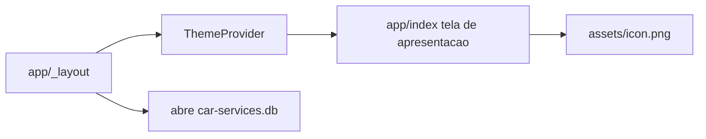

# Setup do app de manutenção de carros

A pasta [car-services](/Users/bbox/Projects/DevTech/car-services) está vazia. O primeiro ciclo entrega só a base e uma tela de apresentação. Cadastro de manutenções fica para depois.

## Decisões

- **App:** Expo (SDK mais recente do `create-expo-app`) + TypeScript, criado na pasta atual.
- **Navegação:** Expo Router com uma única rota (`app/index.tsx`), para as próximas telas entrarem sem reestruturar o projeto.
- **Estilo:** `styled-components` (import de `styled-components/native`) com um tema central. Cor principal **amarelo `#F5C400`**, fundo escuro `#121212`, texto claro. A tela de apresentação usa o amarelo como cor de marca (ícone, título e um bloco de destaque), sem virar uma tela inteira amarela.
- **Banco:** `expo-sqlite`. É leve, local e rápido o bastante para histórico de manutenções (carro, data, serviço, custo). Nesta etapa só abre o arquivo `car-services.db` na inicialização e exporta o acesso. Nenhuma tabela de domínio e nenhuma tela de cadastro.
- **Idioma da UI:** português. Nome do app: **Car Services** (slug `car-services`).
- **Ícone:** imagem gerada de um carro simples, amarelo, fundo escuro, usada como ícone do app (iOS/Android adaptive), splash e logo da tela.

## O que será criado

1. **Scaffold** com `npx create-expo-app@latest . --template blank-typescript`, depois Expo Router, `expo-sqlite` e `styled-components`.
2. **Tema** em `src/theme/theme.ts` e tipos do styled-components, aplicado no `ThemeProvider` do layout raiz.
3. **Banco** em `src/db/index.ts`: abre o SQLite uma vez e expõe `getDatabase()`. Chamado no layout, sem schema ainda.
4. **Tela de apresentação** em `app/index.tsx`: ícone do carro, título “Car Services”, frase curta do tipo “Registros de manutenção do seu carro, mesmo offline.” Sem botões de fluxo.
5. **Ícone** gerado e colocado em `assets/` (`icon.png`, `adaptive-icon.png`, `splash-icon.png`), com `app.json` apontando para eles e `backgroundColor` / `adaptiveIcon.backgroundColor` em `#121212` e amarelo de marca onde fizer sentido no splash.

## Fora deste ciclo

- Tabelas, formulários e listagem de manutenções.
- Autenticação, sync na nuvem e múltiplos veículos na UI.
