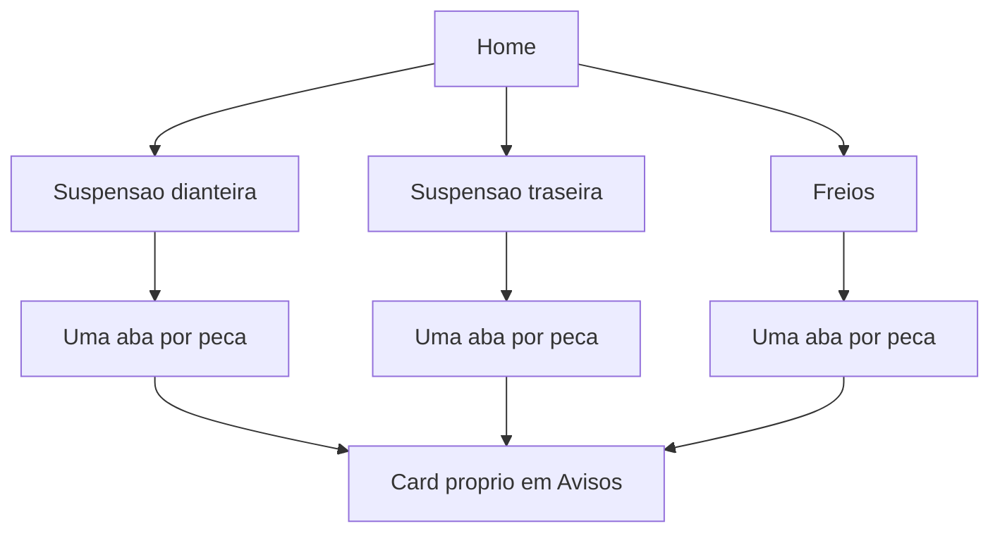

# Suspensão e freios

O formulário de cada aba copia o de [app/(app)/correias.tsx](app/(app)/correias.tsx): data obrigatória, km obrigatória, até 2 fotos e histórico com exclusão. Trocar de aba limpa o rascunho. Não há lado esquerdo/direito nem marca da peça: um registro vale para a peça daquele eixo. O status em Avisos continua só pela data, como nos outros módulos.

Com muitas peças, as abas ficam numa faixa horizontal rolável no topo da tela. O formulário e o histórico abaixo são os mesmos em todas.

## Peças e prazos

O que ocorrer primeiro, a partir do último registro daquela peça. Prazos de referência para carro de passeio; a peça só aparece em Avisos depois do primeiro registro.

Suspensão dianteira:

- Amortecedor: 60.000 km ou 48 meses
- Mola: 80.000 km ou 60 meses
- Batente: 40.000 km ou 36 meses
- Coifa: 40.000 km ou 36 meses
- Coxim: 60.000 km ou 48 meses
- Bandeja: 80.000 km ou 60 meses
- Bucha da bandeja: 40.000 km ou 36 meses
- Pivô: 40.000 km ou 36 meses
- Bieleta: 30.000 km ou 24 meses
- Barra estabilizadora: 100.000 km ou 60 meses
- Bucha da barra estabilizadora: 40.000 km ou 36 meses
- Rolamento de roda: 60.000 km ou 48 meses

Suspensão traseira:

- Amortecedor, mola, batente, coifa e coxim: os mesmos prazos da dianteira
- Bucha do eixo: 50.000 km ou 48 meses
- Braço: 80.000 km ou 60 meses
- Bieleta, barra estabilizadora, bucha da barra e rolamento: os mesmos prazos da dianteira
- Feixe de molas: 80.000 km ou 60 meses

Freios:

- Pastilha dianteira: 20.000 km ou 12 meses
- Disco dianteiro: 40.000 km ou 24 meses
- Pastilha traseira: 40.000 km ou 24 meses
- Disco traseiro: 60.000 km ou 36 meses
- Lona: 40.000 km ou 24 meses
- Tambor: 80.000 km ou 48 meses
- Fluido de freio: 40.000 km ou 24 meses
- Flexível: 60.000 km ou 48 meses
- Pinça: 80.000 km ou 60 meses
- Cilindro de roda: 60.000 km ou 48 meses
- Cilindro mestre: 80.000 km ou 60 meses
- Servofreio: 100.000 km ou 60 meses
- Cabo do freio de estacionamento: 60.000 km ou 48 meses

## Dados

Três tabelas em [src/db/index.ts](src/db/index.ts), no formato de `belt_changes`: `vehicle_id`, coluna de tipo da peça, `changed_on`, `odometer_km`, `photo_uri_1`, `photo_uri_2`, `created_at`.

- `front_suspension_changes` e [src/db/frontSuspensionChanges.ts](src/db/frontSuspensionChanges.ts) mais fotos em `front-suspension-photos/`
- `rear_suspension_changes` e [src/db/rearSuspensionChanges.ts](src/db/rearSuspensionChanges.ts) mais fotos em `rear-suspension-photos/`
- `brake_changes` e [src/db/brakeChanges.ts](src/db/brakeChanges.ts) mais fotos em `brake-photos/`

Lista, criação, exclusão e próximo prazo recebem o tipo da peça e o veículo ativo. A data seguinte usa `addMonthsClamped` de [src/db/engineOilChanges.ts](src/db/engineOilChanges.ts).

## Telas e Avisos

Rotas novas em [app/(app)/_layout.tsx](app/(app)/_layout.tsx) e três cards no fim da grade de [app/(app)/home.tsx](app/(app)/home.tsx): Suspensão dianteira, Suspensão traseira e Freios.

Em [app/(app)/avisos.tsx](app/(app)/avisos.tsx), um card por peça, agrupado sob o título do módulo. Sem registro, a mesma mensagem vazia dos outros módulos.

Atualizar a tabela de módulos em [README.md](README.md).

## Verificação

`npx tsc --noEmit` e `npx expo lint`. No app: salvar duas peças diferentes no mesmo módulo e conferir que o histórico de uma não aparece na outra; apagar um item; abrir Avisos e ver o prazo só da peça registrada.