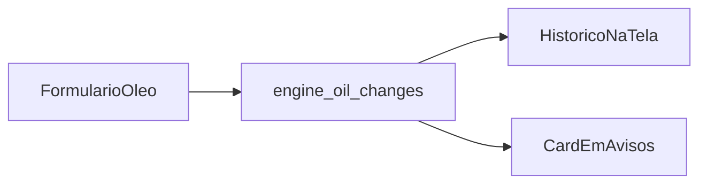

# Troca de óleo do motor e aviso

A tela [`app/(app)/oleo-motor.tsx`](app/(app)/oleo-motor.tsx) e a [`app/(app)/avisos.tsx`](app/(app)/avisos.tsx) hoje só renderizam o placeholder [`ModuleScreen`](src/components/ModuleScreen.tsx). Os registros ficam no mesmo SQLite de [`src/db/index.ts`](src/db/index.ts), sempre do veículo ativo.

## Regra do aviso

A partir da troca mais recente do veículo ativo (data da troca, e em empate a mais nova salva):

- Próxima data = essa data mais 12 meses (dia inexistente, como 31, cai no último dia do mês).
- Próxima quilometragem = km informado mais 10.000.

Avisos mostra os dois limites juntos: “até DD/MM/AAAA ou aos X km, o que ocorrer primeiro”. Se a data de hoje já passou desse dia, o card marca a troca como vencida pela data. Não há odômetro ao vivo entre as trocas, então o km aparece como meta, sem dizer que “já venceu por km”.

Sem nenhuma troca registrada, Avisos mostra que ainda não há prazo de óleo do motor.

## Dados

Nova tabela `engine_oil_changes` na migração existente:

- `vehicle_id` ligado ao veículo
- `changed_on` em `YYYY-MM-DD` (data local, sem hora)
- `odometer_km` inteiro
- `created_at`

Acesso em um módulo novo, no mesmo estilo de [`src/db/vehicles.ts`](src/db/vehicles.ts): listar por veículo (mais recente primeiro), inserir e calcular o próximo prazo. Constantes `10_000` e `12` ficam num único lugar.

## Tela de óleo

Substitui o placeholder. O título continua no header da stack (“Óleo do motor”).

- Data abre no dia de hoje. Toque abre o seletor nativo (`npx expo install @react-native-community/datetimepicker`, incluso no Expo Go no SDK 57). Não aceita data futura.
- Quilometragem atual: teclado numérico, inteiro maior que zero.
- Botão salva no veículo ativo, limpa o km e volta a data para hoje.
- Abaixo, histórico com data em `DD/MM/AAAA` e km (ex.: `45.000 km`). Vazio: “Nenhuma troca registrada.”
- Nesta entrega o histórico só é lido. Sem editar nem apagar.

A tela recarrega ao ganhar foco (`useFocusEffect`), para refletir troca de veículo.

## Tela de avisos

Um card com a última troca e os dois limites. Também recarrega ao focar, então um registro novo aparece ao voltar para Avisos.

## Verificação

`npx tsc --noEmit` e `npx expo lint`. No app: registrar uma troca, ver o histórico, abrir Avisos com data e km, e conferir que outro veículo ativo não mistura os registros.
