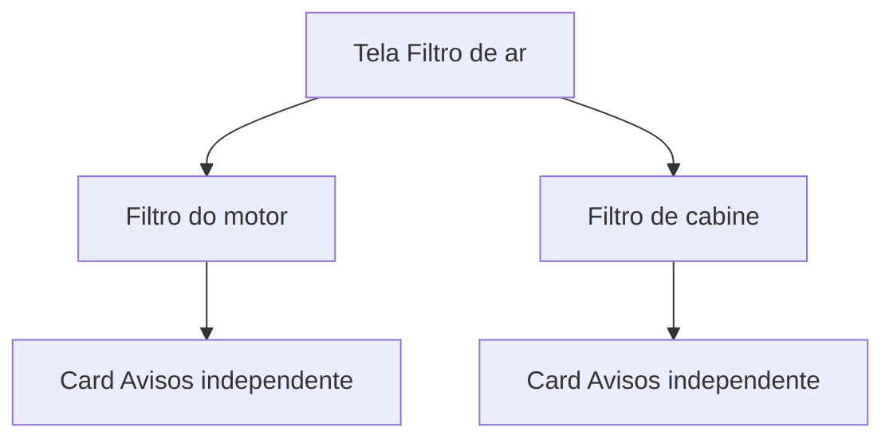

# Troca dos filtros

As rotas já existem. As telas [`app/(app)/filtro-combustivel.tsx`](app/(app)/filtro-combustivel.tsx) e [`app/(app)/filtro-ar.tsx`](app/(app)/filtro-ar.tsx) ainda são o placeholder de [`src/components/ModuleScreen.tsx`](src/components/ModuleScreen.tsx). O fluxo copia o de [`app/(app)/velas.tsx`](app/(app)/velas.tsx) e, no filtro de ar, o de [`app/(app)/correias.tsx`](app/(app)/correias.tsx): data obrigatória, km obrigatória, até 2 fotos e histórico com exclusão. Sem marca nem código da peça.

O status colorido em Avisos continua só pela data. O app não guarda a quilometragem atual do veículo. A home segue com os dois cards atuais.

## Prazos

O que ocorrer primeiro, a partir do último registro de cada tipo:

- Filtro de combustível: 20.000 km ou 12 meses
- Filtro de ar do motor: 15.000 km ou 12 meses
- Filtro de cabine: 10.000 km ou 12 meses

## Dados

Novas tabelas em [`src/db/index.ts`](src/db/index.ts), ligadas a `vehicles`:

- `fuel_filter_changes`: `changed_on`, `odometer_km`, `photo_uri_1`, `photo_uri_2`, `created_at`
- `air_filter_changes`: os mesmos campos mais `filter_kind` (`engine` ou `cabin`)

CRUD no mesmo formato de velas e correias:

- [`src/db/fuelFilterChanges.ts`](src/db/fuelFilterChanges.ts) e [`src/db/fuelFilterPhotos.ts`](src/db/fuelFilterPhotos.ts) — pasta `fuel-filter-photos/`
- [`src/db/airFilterChanges.ts`](src/db/airFilterChanges.ts) e [`src/db/airFilterPhotos.ts`](src/db/airFilterPhotos.ts) — pasta `air-filter-photos/`

Cada lista, criação e exclusão usa o veículo ativo. `listAirFilterChanges` e `getNextAirFilterDue` recebem o `filter_kind`. A data seguinte usa `addMonthsClamped` de [`src/db/engineOilChanges.ts`](src/db/engineOilChanges.ts). Até 2 fotos, copiadas ao salvar e apagadas junto com o registro.

## Telas

Filtro de combustível substitui o placeholder pelo formulário de velas.

Filtro de ar fica na rota `/filtro-ar`. No topo, duas visões — **Filtro do motor** e **Filtro de cabine**. Cada uma tem formulário e histórico próprios. Trocar de visão limpa o rascunho (data de hoje, km vazio, fotos descartadas), para um registro não ir para o filtro errado.

## Avisos

Em [`app/(app)/avisos.tsx`](app/(app)/avisos.tsx), três cards depois dos que já existem:

- Filtro de combustível
- Filtro de ar do motor
- Filtro de cabine

Sem registro, a mesma mensagem vazia dos outros módulos.

Atualizar a tabela de módulos e a seção “Ainda por vir” em [`README.md`](README.md). Esses dois módulos saem de “só texto”.

## Verificação

`npx tsc --noEmit` e `npx expo lint`. No app: salvar combustível, motor e cabine; conferir que o histórico de um não aparece no outro; apagar um item; abrir Avisos e ver os três prazos separados.
