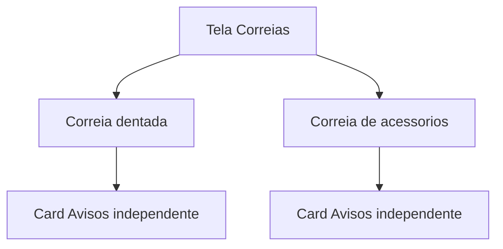

# Velas, bobinas e correias

As rotas e os cards da home já existem. As telas em [`app/(app)/velas.tsx`](app/(app)/velas.tsx), [`app/(app)/bobinas.tsx`](app/(app)/bobinas.tsx) e [`app/(app)/correias.tsx`](app/(app)/correias.tsx) ainda são o placeholder de [`src/components/ModuleScreen.tsx`](src/components/ModuleScreen.tsx). O fluxo novo copia o de [`app/(app)/oleo-cambio.tsx`](app/(app)/oleo-cambio.tsx) e [`src/db/transmissionOilChanges.ts`](src/db/transmissionOilChanges.ts), sem campo extra: só data, km e fotos.

O status colorido continua só pela data, como nos outros módulos. O app não guarda a quilometragem atual do veículo.

## Prazos

O que ocorrer primeiro, a partir do último registro:

- Velas: 30.000 km ou 24 meses
- Bobinas: 60.000 km ou 48 meses
- Correia dentada: 60.000 km ou 60 meses
- Correia de acessórios: 40.000 km ou 48 meses

## Dados

Novas tabelas em [`src/db/index.ts`](src/db/index.ts), ligadas a `vehicles`:

- `spark_plug_changes` e `ignition_coil_changes`: `changed_on`, `odometer_km`, `photo_uri_1`, `photo_uri_2`, `created_at`
- `belt_changes`: os mesmos campos mais `belt_kind` (`timing` ou `accessory`)

CRUD no mesmo formato do óleo de câmbio:

- [`src/db/sparkPlugChanges.ts`](src/db/sparkPlugChanges.ts) e [`src/db/sparkPlugPhotos.ts`](src/db/sparkPlugPhotos.ts) — pasta `spark-plug-photos/`
- [`src/db/ignitionCoilChanges.ts`](src/db/ignitionCoilChanges.ts) e [`src/db/ignitionCoilPhotos.ts`](src/db/ignitionCoilPhotos.ts) — pasta `ignition-coil-photos/`
- [`src/db/beltChanges.ts`](src/db/beltChanges.ts) e [`src/db/beltPhotos.ts`](src/db/beltPhotos.ts) — pasta `belt-photos/`

Cada módulo lista, cria e apaga pelo veículo ativo. `listBeltChanges` e `getNextBeltDue` recebem o `belt_kind`. A data seguinte usa `addMonthsClamped` de [`src/db/engineOilChanges.ts`](src/db/engineOilChanges.ts). Até 2 fotos, copiadas ao salvar e apagadas junto com o registro.

## Telas

Velas e bobinas substituem o placeholder pelo formulário já usado no óleo de câmbio: data obrigatória, km obrigatória, até 2 fotos (galeria ou câmera) e histórico com exclusão.

Correias fica numa rota só. No topo, duas visões alternáveis — **Correia dentada** e **Correia de acessórios**. Cada uma tem formulário e histórico próprios. Trocar de visão limpa o rascunho, para um registro não ir para a correia errada.

## Avisos

Em [`app/(app)/avisos.tsx`](app/(app)/avisos.tsx), quatro cards depois dos que já existem, cada um com última troca, próxima data ou km e status “vencida pela data” / “dentro do prazo pela data”:

- Velas
- Bobinas
- Correia dentada
- Correia de acessórios

Sem registro, a mesma mensagem vazia dos outros módulos. A home continua com um único card Correias.

Atualizar a tabela de módulos e a seção “Ainda por vir” em [`README.md`](README.md). Filtro de combustível e filtro de ar permanecem como texto.
