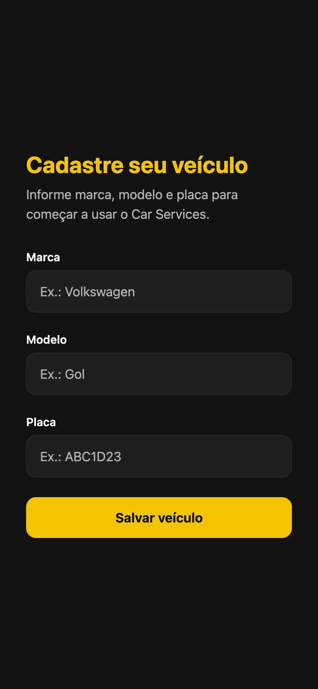
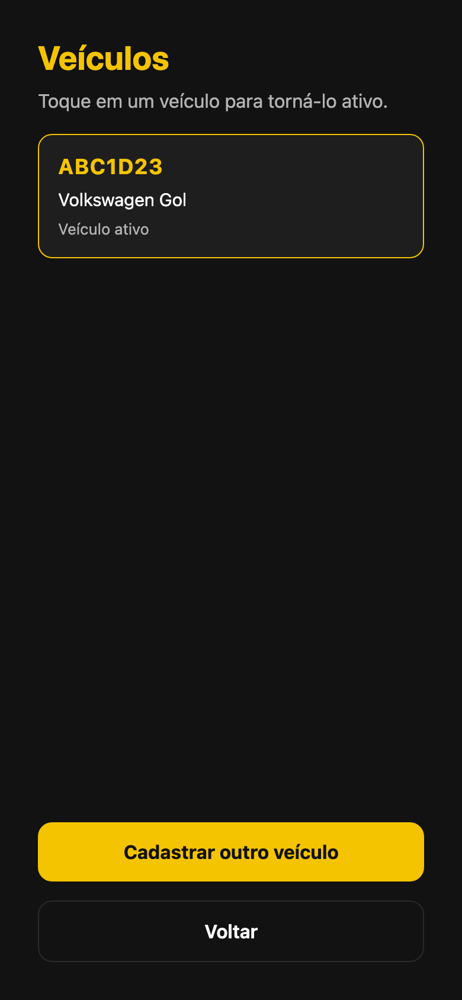
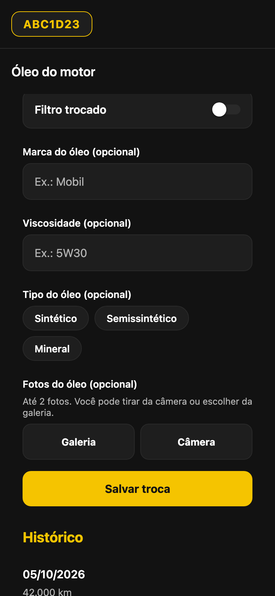
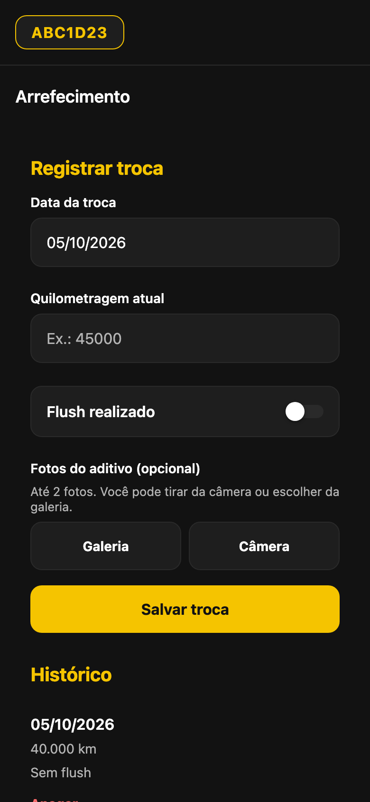
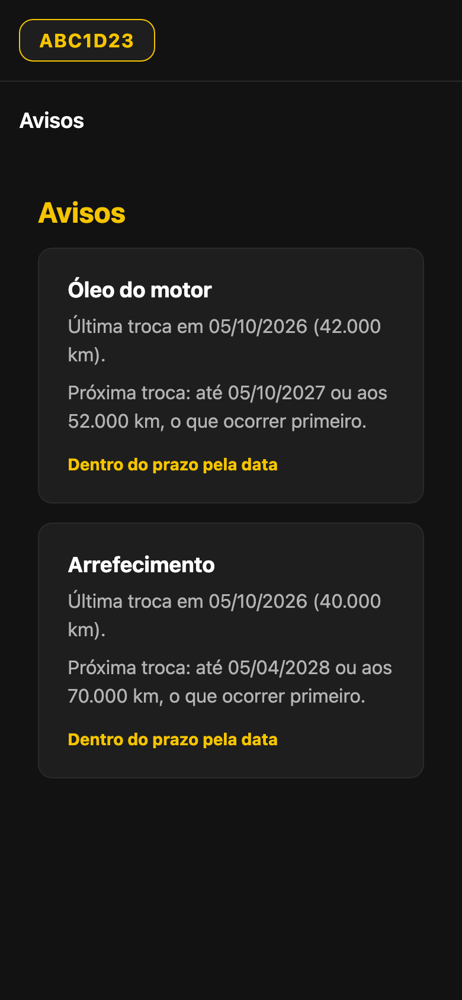

# Car Services

<p align="center">
  
</p>

<p align="center">
  
</p>

**Car Services** é um app mobile para registrar a manutenção do seu carro no próprio aparelho — sem conta, sem nuvem e sem depender do recibo da oficina.

## Por que existe

O histórico de óleo, filtro e arrefecimento costuma ficar espalhado: recibo de papel, mensagem no WhatsApp da oficina ou só na memória. Quando o carro troca de mão, ou quando a próxima troca vence, esse registro some.

O Car Services guarda isso onde quem dirige consegue olhar: data, quilometragem, detalhes da troca e fotos. Os dados ficam no SQLite local (`car-services.db`) e as fotos no armazenamento do app. Sem login e sem sincronização.

## Como funciona

1. No primeiro uso, cadastre marca, modelo e placa.
2. A placa do veículo ativo fica no topo; toque nela para trocar ou cadastrar outro.
3. Na home, escolha o módulo do serviço que quer acompanhar.
4. Em óleo do motor e arrefecimento, registre a troca e veja o histórico.
5. Em Avisos, confira a próxima data e quilometragem sugeridas.

Um veículo fica ativo por vez. Os registros de manutenção ficam ligados a esse veículo.

## O que dá para registrar hoje

| Módulo | Situação | Intervalo usado nos avisos |
| --- | --- | --- |
| **Óleo do motor** | Completo: data, km, filtro, marca, viscosidade, tipo e até 2 fotos | 10.000 km ou 12 meses |
| **Arrefecimento** | Completo: data, km, flush e até 2 fotos | 30.000 km ou 18 meses |
| **Avisos** | Próxima troca e status por data (em dia ou atrasado) | Calculado a partir do último registro |
| **Óleo de câmbio** | Texto de apresentação | — |
| **Velas, bobinas e correias** | Texto de apresentação | — |

## Telas

### Cadastro do primeiro veículo

O app só libera a home depois do primeiro veículo.



### Módulos

Grade com os cinco módulos de manutenção.


### Veículos

Lista para ativar um carro ou cadastrar outro, aberta pela placa no topo.



### Óleo do motor

Formulário de troca com histórico por data e quilometragem.



### Arrefecimento

Registro de troca de arrefecimento, com opção de flush e fotos.



### Avisos

Resumo da próxima troca de óleo e de arrefecimento do veículo ativo.



## Stack

- **Expo SDK 57** + React Native + TypeScript
- **Expo Router** para navegação
- **styled-components** com tema escuro e amarelo (`#F5C400` em `src/theme/theme.ts`)
- **expo-sqlite** para o banco local
- **expo-image-picker** e **expo-file-system** para fotos das trocas
- **EAS** com perfil `preview` para gerar APK Android interno

## Como rodar

Requisito: **Node.js ≥ 20.19.4** (recomendado: Node 22 LTS).

```bash
npm install
npx expo start
```

No menu do Expo, abra no Android, iOS ou web.

Para gerar um APK de distribuição interna:

```bash
npx eas-cli@latest build --platform android --profile preview
```

O perfil está em [`eas.json`](eas.json).

> Na web, o SQLite precisa de suporte a `.wasm` e dos headers COOP/COEP. O projeto já inclui isso em [`metro.config.js`](metro.config.js).

## Onde está o código

| Pasta | Conteúdo |
| --- | --- |
| `app/` | Rotas e telas (Expo Router) |
| `src/db/` | Schema SQLite, veículos, óleo, arrefecimento e fotos |
| `src/vehicles/` | Contexto do veículo ativo |
| `src/components/` | Formulário, header da placa e telas-placeholder |
| `src/theme/` | Cores, espaçamento e styled-components |
| `docs/images/` | Imagens usadas neste README |
| `assets/` | Ícone, splash e adaptive icon |

## Ainda por vir

Os módulos de óleo de câmbio e de velas, bobinas e correias ainda são só texto. O próximo passo natural é o mesmo fluxo de registro e avisos que óleo do motor e arrefecimento já têm.
